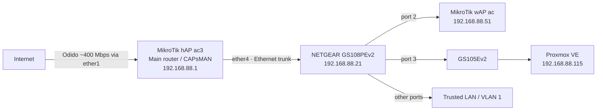

# Home Network Topology

[Home network index](README.md)

## Physical Topology



Known physical links:

- Odido uplink -> hAP ac3 `ether1`
- hAP ac3 `ether4` -> GS108PEv2 port 1
- GS108PEv2 port 2 -> MikroTik wAP ac `ether1`
- GS108PEv2 port 3 -> GS105Ev2
- GS105Ev2 -> Proxmox host
- GS105Ev2 -> Unraid server (`192.168.88.96`)

## Current Logical Topology

```mermaid
flowchart LR
    internet[Internet] -->|Odido VLAN 300| wan[vlan-internet on hAP]
    wan --> hap[MikroTik hAP ac3<br/>192.168.88.1<br/>VLAN 1 / Trusted<br/>VLAN 20 / IoT]
    hap -->|ether4 trunk<br/>VLAN 1 untagged<br/>VLAN 20 tagged| gs108[GS108PEv2<br/>192.168.88.21]
    gs108 -->|port 2 trunk<br/>VLAN 1 + VLAN 20| wap[wAP ac<br/>192.168.88.51]
    wap --> trustedSsid[Trusted SSID(s)]
    wap --> iotSsid[IoT SSID VLAN 20]
    gs108 -->|port 3 access-like<br/>VLAN 1 only| gs105[GS105Ev2]
    gs105 --> proxmox[Proxmox<br/>192.168.88.115]
    proxmox --> homeAssistant[Home Assistant<br/>192.168.88.31]
    proxmox --> talos[Talos<br/>192.168.88.26]
```
